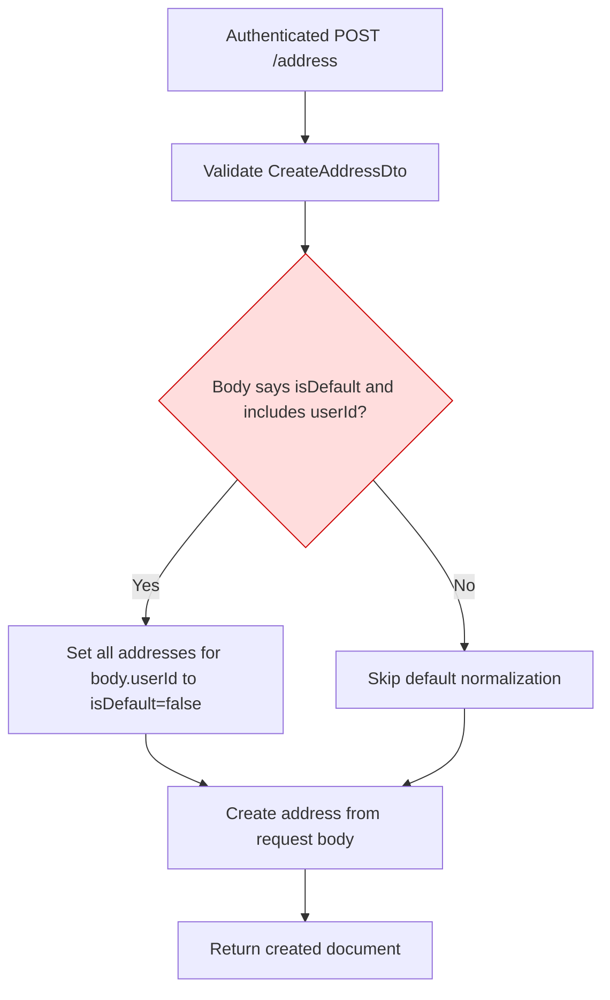
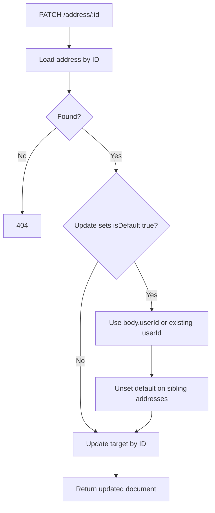
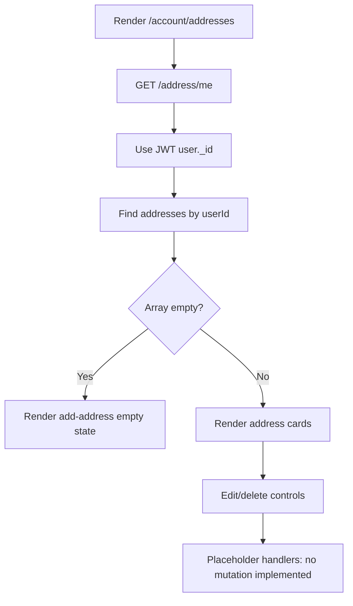

# Address Module Flows

Confidence: 🟢 **CONFIRMED** unless marked otherwise.

## Create/default-address flow

🔴 Ownership comes from an optional body field rather than the authenticated user. The current frontend omits that field.

## Update/default-address flow

## Customer address page

