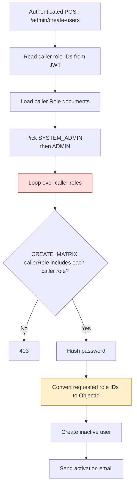
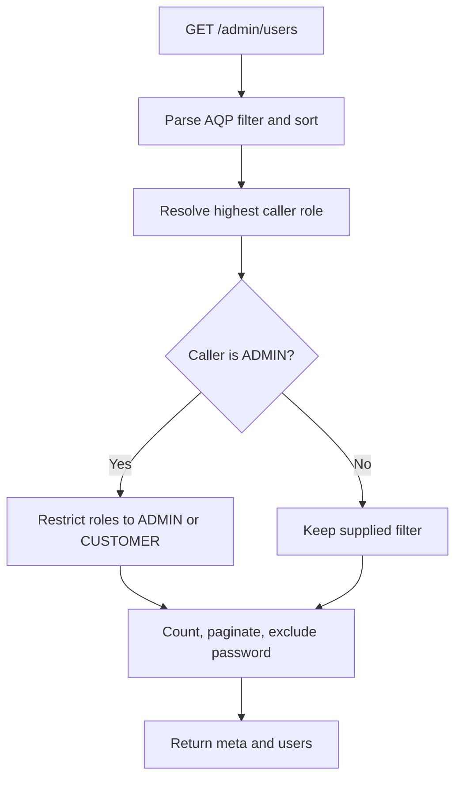

# Admin Module Flows

## Internal user creation as implemented

🔴 The policy loop validates caller roles rather than requested roles. Role metadata also lacks an attached/global RolesGuard on this controller.

## User listing

