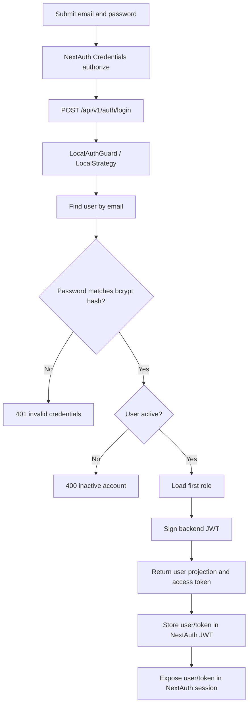
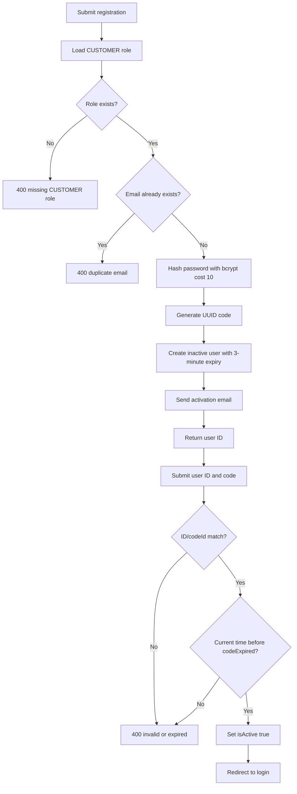
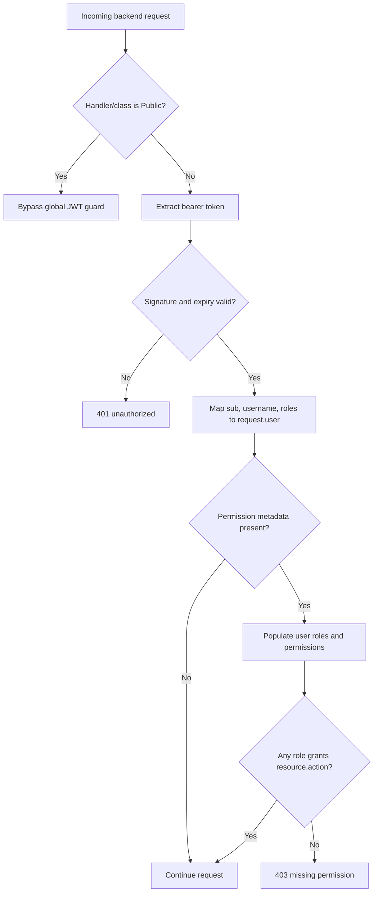
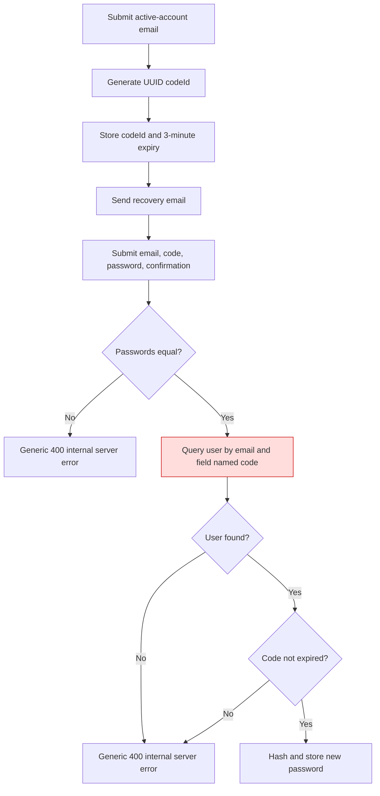

# Auth Module Flows

Confidence: 🟢 **CONFIRMED** unless a node is explicitly marked otherwise.

## Login and session creation

## Registration and activation

## Authenticated request and permission check

## Password recovery as implemented

🔴 The highlighted query uses `code`, while generated and persisted codes use `codeId`; this is a likely broken recovery path.
